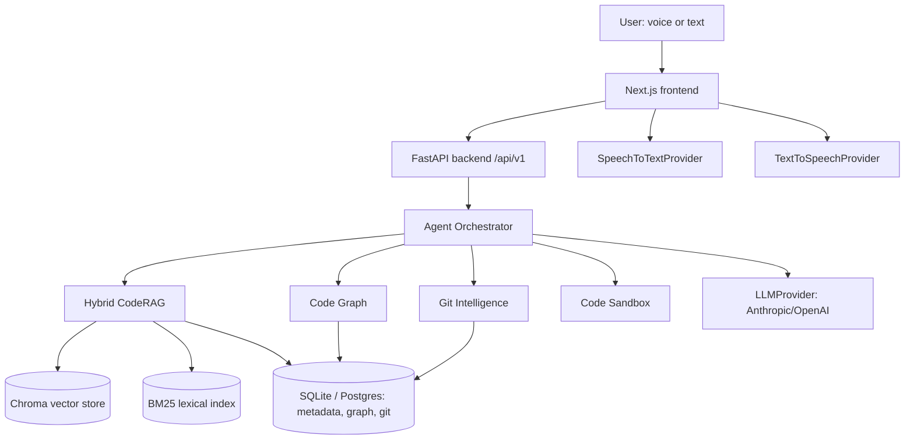
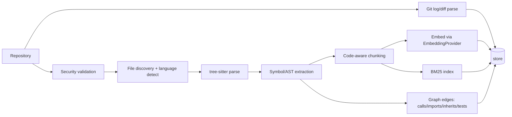
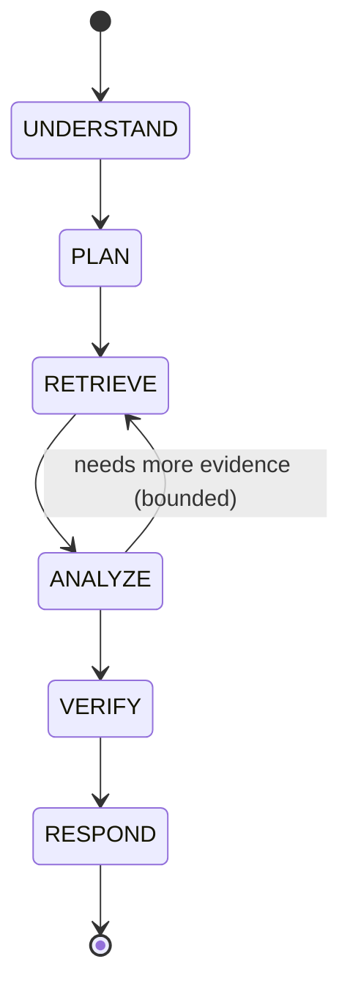

# Architecture

## System overview

## Repository indexing pipeline

## Agent state machine (query/answer path)

Action path (code modification, and test generation which reuses the same pipeline)
adds PROPOSE → AUTHORIZE (human gate, explicit `authorized: true`) → MODIFY → TEST →
VERIFY before RESPOND, per [module 32 of the spec]. Every agent run enforces
max_iterations, max_tool_calls, wall-clock timeout, and a token budget; repeated
identical tool calls abort the loop and force replanning.

**Orchestrator-level evidence-first enforcement** (added after real evaluation data
showed 8/11 benchmark failures were the model answering with zero tool calls despite
a system-prompt instruction not to — see
[docs/EVALUATION_FAILURE_ANALYSIS.md](EVALUATION_FAILURE_ANALYSIS.md)): if the model
tries to give a final answer without ever having called a tool, the orchestrator
rejects it and injects a corrective message forcing a real tool call, up to 2 times
(bounded independently of `max_iterations`). This is implemented in
`packages/agents/state_machine.py::run_agent`, not just prompted for — see
`tests/rag/test_agent_orchestration.py` for deterministic (no-live-LLM) proof this
actually intercepts a premature answer.

**Specialized agent flows**, all reusing this same bounded loop with a different
system prompt rather than separate implementations:
- **General query agent** (`run_agent`) — CONFIRMED/INFERRED/UNKNOWN.
- **Debugging agent** (`run_debug_agent`, `/api/v1/debug`) — adds a ranked-hypothesis
  workflow and a fourth CONFIRMED/HYPOTHESIS/INFERRED/UNKNOWN category, since a
  plausible-but-unverified root cause is a different epistemic status than either a
  confirmed fact or an inference from confirmed facts.
- **Test generation** (`generate_tests`, `/api/v1/tests/generate`) — investigates
  existing test style, proposes a new/extended test file (supports creating a
  brand-new test file, not just editing one), then reuses `apply_fix`'s isolated-
  worktree + real sandboxed test execution — never claims a generated test passes
  without actually running it.

**Impact analysis and Git intelligence tools** (`packages/agents/tools.py`):
`analyze_impact` (direct + one-hop-indirect callers, callees, tests covering a
symbol, and an explainable risk heuristic) and `co_changed_files` (Git co-change
history: which files historically change together with a given file).

## Data model (V1, SQLite; same schema targets Postgres)

`repositories`, `branches`, `commits`, `files`, `symbols`, `chunks`, `edges`
(graph: source_symbol_id, target_symbol_id, relation), `conversations`, `messages`,
`agent_runs`, `tool_calls`, `citations`. Migrations via Alembic.

## Directory layout

Matches spec section 92 (`apps/`, `packages/`, `workers/`, `infrastructure/`, `tests/`,
`evaluation/`, `docs/`, `scripts/`).

## Provider abstractions (`packages/shared/providers.py`)

`LLMProvider`, `EmbeddingProvider`, `RerankerProvider`, `SpeechToTextProvider`,
`TextToSpeechProvider` — all configured via environment variables, none hardcoded into
business logic. See [DECISIONS.md](DECISIONS.md) for default implementations.

## What is NOT built yet

Tracked honestly in [PROJECT_STATUS.md](PROJECT_STATUS.md) — do not infer completeness
from this document; it describes the target shape, not current state.
