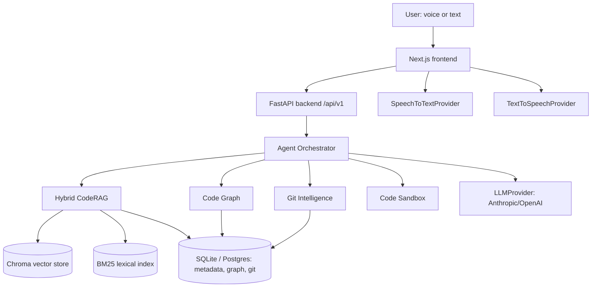
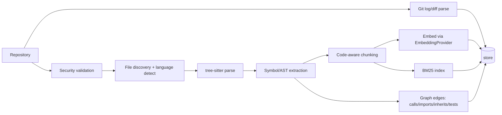
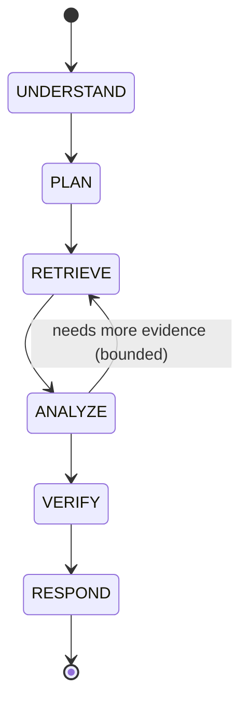

# Architecture

## System overview

## Repository indexing pipeline

## Agent state machine (query/answer path)

Action path (code modification) adds PROPOSE → AUTHORIZE (human gate) → MODIFY → TEST
→ VERIFY before RESPOND, per [module 32 of the spec]. Every agent run enforces
max_iterations, max_tool_calls, wall-clock timeout, and a token budget; repeated
identical tool calls abort the loop and force replanning.

## Data model (V1, SQLite; same schema targets Postgres)

`repositories`, `branches`, `commits`, `files`, `symbols`, `chunks`, `edges`
(graph: source_symbol_id, target_symbol_id, relation), `conversations`, `messages`,
`agent_runs`, `tool_calls`, `citations`. Migrations via Alembic.

## Directory layout

Matches spec section 92 (`apps/`, `packages/`, `workers/`, `infrastructure/`, `tests/`,
`evaluation/`, `docs/`, `scripts/`).

## Provider abstractions (`packages/shared/providers.py`)

`LLMProvider`, `EmbeddingProvider`, `RerankerProvider`, `SpeechToTextProvider`,
`TextToSpeechProvider` — all configured via environment variables, none hardcoded into
business logic. See [DECISIONS.md](DECISIONS.md) for default implementations.

## What is NOT built yet

Tracked honestly in [PROJECT_STATUS.md](PROJECT_STATUS.md) — do not infer completeness
from this document; it describes the target shape, not current state.
